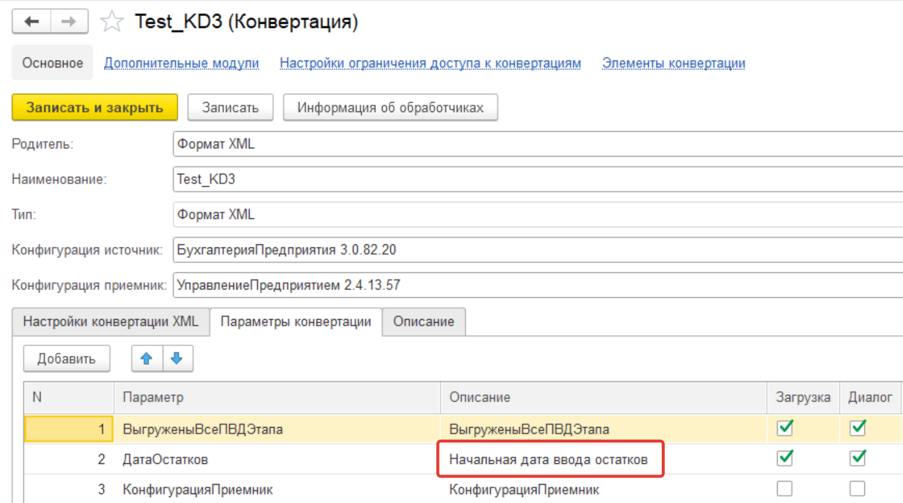

# PEN007_CONV3_PLUS
"Конвертация данных Плюс" Расширение для конфигурации КД3 с набором полезных инструментов:

## Полезные инструменты
### Переход к ПКО
На формах правил есть кнопки, открывающие правило конвертации объектов (ПКО) в отдельной вкладке
(окно не подчиняется форме-источнику):

* форма правила конвертации свойств (ПКС) — «Перейти к правилу конвертации»: открывает ПКО или правило
  конвертации предопределенных данных, указанное в поле «Правило конвертации св-ва» (только в конвертациях
  типа XDTO);
* форма правила обработки данных (ПОД) — «Перейти к ПКО»: открывает ПКО, указанное в поле «Правило конвертации
  объекта», а в режиме «несколько правил» — ПКО, выделенное в списке правил конвертации объектов.

### Выгрузка и загрузка описания параметров правил
Теперь описания параметров выгружаются вместе с выгрузкой правил. Например:

